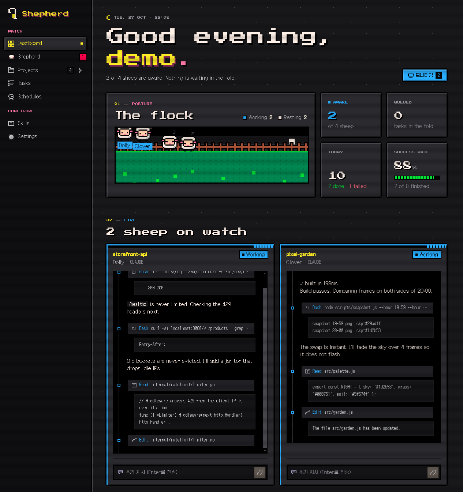
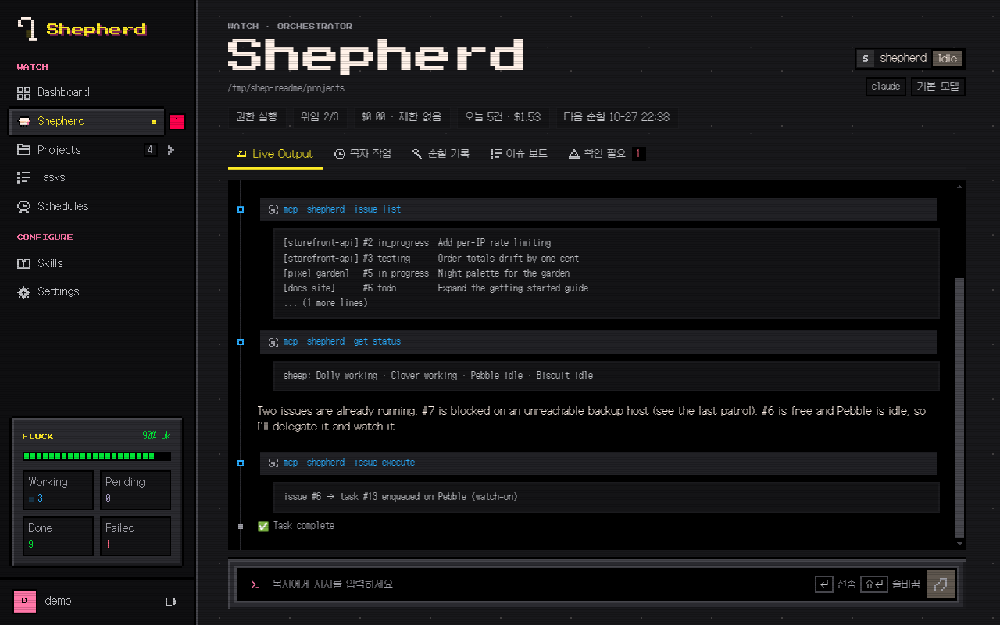
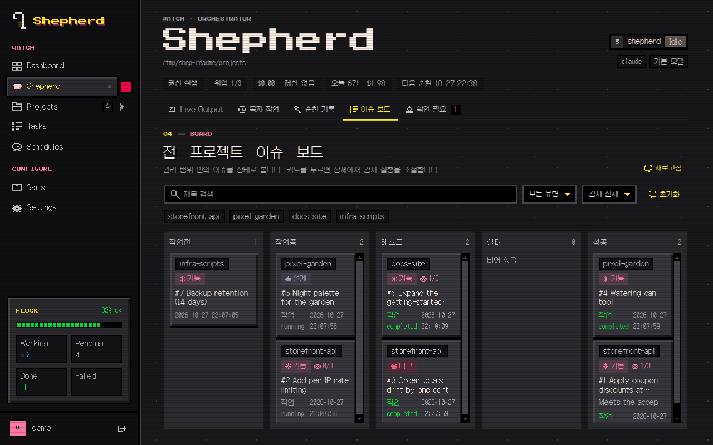
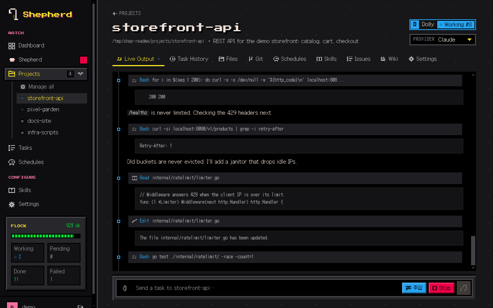
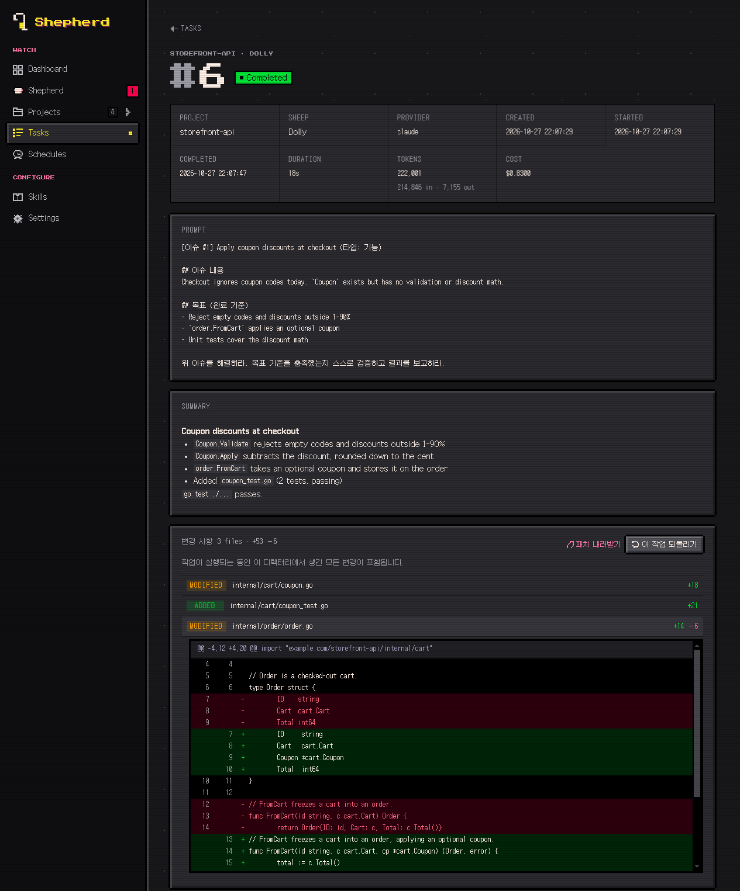
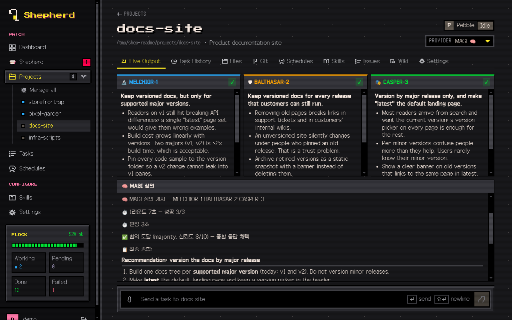
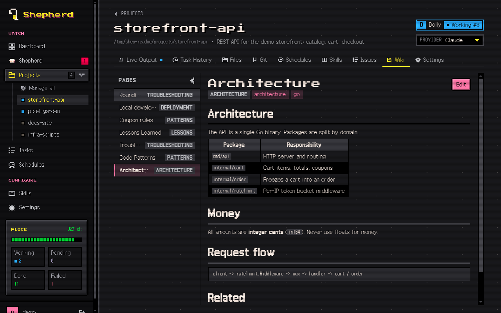

# Shepherd

A self-hosted control room for a flock of AI coding agents. Each project gets its own agent (a "sheep"), and a manager agent (the "shepherd") hands out work, watches it, and reviews the results. You drive all of it from one Web UI.

> 한국어 문서는 [README_KO.md](README_KO.md)를 참고하세요.



## Highlights

- **One sheep per project.** Sheep run in parallel, each in its own repository, with live streamed output.
- **A shepherd that manages the flock.** You tell the shepherd what you want. It writes issues, delegates them to project sheep, wakes up when the work finishes, and reviews the result.
- **Every change is reversible.** Shepherd snapshots the working tree before and after each task, so you can see exactly what a task changed and revert it.
- **Many AI backends.** Claude Code, OpenCode, Pi, and Grok CLIs, local or hosted models through the built-in agent, and MAGI, a three-model consensus engine.
- **Project memory.** Each project has an issue tracker and a wiki that the agents read and update.
- **Runs on your machine.** A single Go binary with the Web UI embedded. Installable as a PWA with push notifications.

## The Web UI

### Dashboard

The dashboard shows the whole flock at a glance: which sheep are working or resting, live output from every running task, token usage by project and model (5 hours to 1 year), and recent tasks. You can send extra instructions to a running sheep from its card. The monitor view puts all running tasks side by side.

### Shepherd

The shepherd is a manager agent with no project of its own. It never edits code. It delegates through issues:

1. You give it an instruction in the console.
2. It creates or picks issues and runs them on the right project sheep, with **watch** turned on.
3. When a watched task finishes, the shepherd wakes up and reviews it. It closes the issue, re-runs it with more guidance, or opens a follow-up issue.
4. A periodic **patrol** checks all projects with plain code (no LLM) and wakes the shepherd only for new problems, such as failed or stuck tasks.



The shepherd screen also has its task history, the patrol log, a **cross-project issue board**, and a **needs-attention** list for things that need your decision. Autonomy tiers (report, plan, execute, full) and daily caps on wakes, active delegations, and cost keep it under control. You set all of this in **Settings → 목자 (Shepherd)**.



### Project workspace

Each project has a workspace with these tabs: **Live Output**, **Task History**, **Files**, **Git**, **Schedules**, **Skills**, **Issues**, **Wiki**, and **Settings**. From Live Output you send tasks, add instructions to a running task, or stop it. You can change the sheep's provider and model in the header.



- **Files**: browse and download project files.
- **Git**: commit graph, branches, and diffs. Stage, commit, and push from the browser.
- **Issues**: a small tracker (design, feature, bug). **Execute** turns an issue into a queued task that stays linked to the issue.
- **Schedules**: cron or interval jobs that create tasks automatically.
- **Settings**: per-project options, such as which MCP servers the sheep can use.

### Task changes and revert

The task detail page shows the prompt, the summary, cost and tokens, the full output, and **every file the task changed**, with a diff per file. You can download the changes as a patch or revert the task. The revert uses a 3-way merge, so edits made after the task are kept. Shepherd stores the snapshots in hidden git refs and does not touch your index, HEAD, or commit history.



### MAGI: three models, one answer

MAGI asks three proposers the same question in parallel, each with a different persona (MELCHIOR-1: technical precision, BALTHASAR-2: safety, CASPER-3: practicality). A separate judge compares the answers and writes one synthesis. Low agreement triggers an anonymous debate round. Each proposer can use a different backend, and mixing model families is recommended. MAGI gives advice only: proposers can read files and use the browser, but they cannot edit code.



### Wiki

Each project has a markdown wiki for architecture notes, gotchas, and runbooks. Agents read the relevant pages before they start and can add or update pages when they finish, so knowledge carries over between tasks.



### More

- **Skills**: reusable prompt templates, global or per project. Agents load the full text only when they need it.
- **Notifications**: PWA Web Push and Discord webhooks for finished and failed tasks and for shepherd reports.
- **Sheep names**: when you add a project, an LLM can give its new sheep a name that fits the project. You can rename sheep at any time.
- **Account**: change the login name and password in **Settings → 공통 (Common)**. Changing them signs out all other sessions.

## Providers

Each sheep uses one provider. You can mix providers in one flock and change a sheep's provider at any time.

| Provider | Backend |
|----------|---------|
| `claude` | Claude Code CLI (default) |
| `opencode` | OpenCode CLI |
| `pi` | Pi coding agent CLI |
| `grok` | Grok CLI |
| `embedded` | Built-in agent loop for any OpenAI-compatible endpoint (llama.cpp, vLLM, Ollama, LM Studio, GitHub Copilot) |
| `magi` | Three-model consensus over the backends above |

The CLI providers use their own login, so Shepherd does not store API keys for them. You add embedded endpoints and configure MAGI in **Settings**.

## Getting started

Requirements: **Go 1.25+**, **Node.js 18+**, and at least one provider (for example the Claude Code CLI in `PATH`, or an OpenAI-compatible endpoint).

```bash
git clone https://github.com/agurrrrr/shepherd.git
cd shepherd
make install            # builds the Web UI and the binary, copies it to ~/.local/bin

shepherd auth setup     # create the Web UI login
shepherd serve -d       # start the daemon
```

Open `http://localhost:8585`, sign in, and add your first project from **Projects → Add project**. Shepherd creates a sheep for it, and you can start sending tasks.

Settings are stored in `~/.shepherd/config.yaml`, and the task database is `~/.shepherd/shepherd.db`. You can change almost every option from the **Settings** page. For access from outside your network, put a reverse proxy with HTTPS in front of the daemon.

Shepherd also runs as an MCP server (`shepherd mcp`). This gives agents tools for issues, the wiki, task history, skills, and browser automation.

## Development

```bash
go build ./... && go test ./...
cd web && npm install && npm run dev    # Web UI dev server
```

See [CONTRIBUTING.md](CONTRIBUTING.md) and [ARCHITECTURE.md](ARCHITECTURE.md).

## License

MIT. See [LICENSE](LICENSE).

---

> ***"The Lord is my shepherd; I shall not want."*** (Psalm 23:1)
