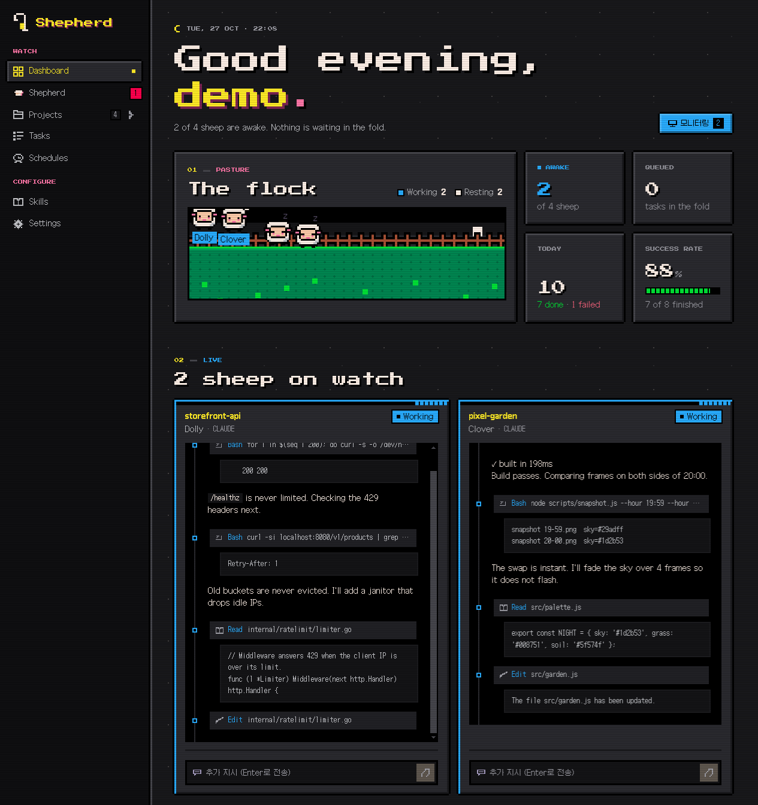
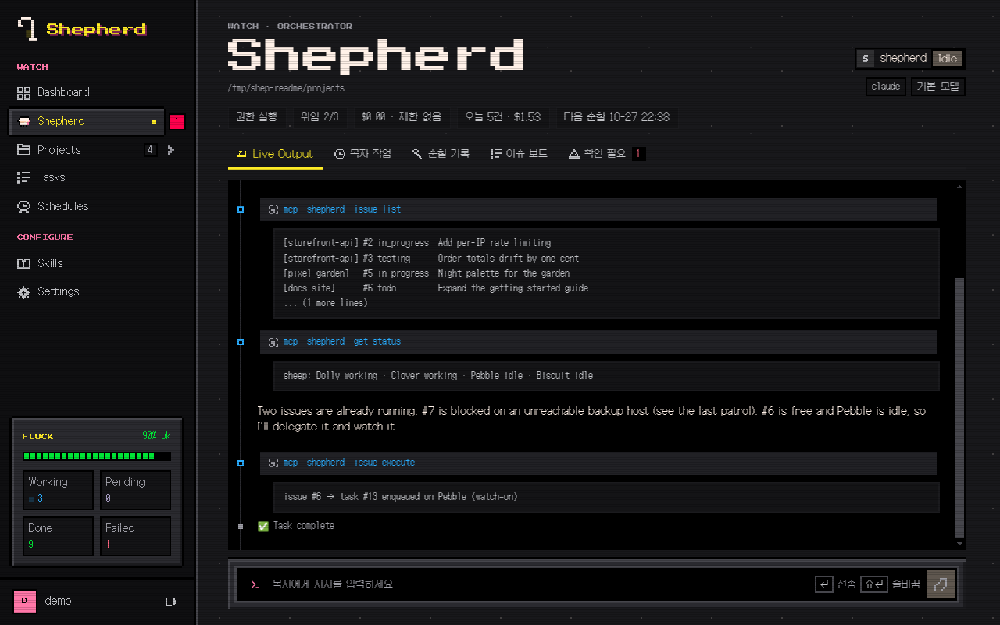
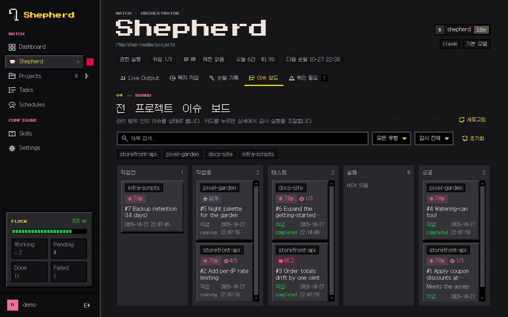
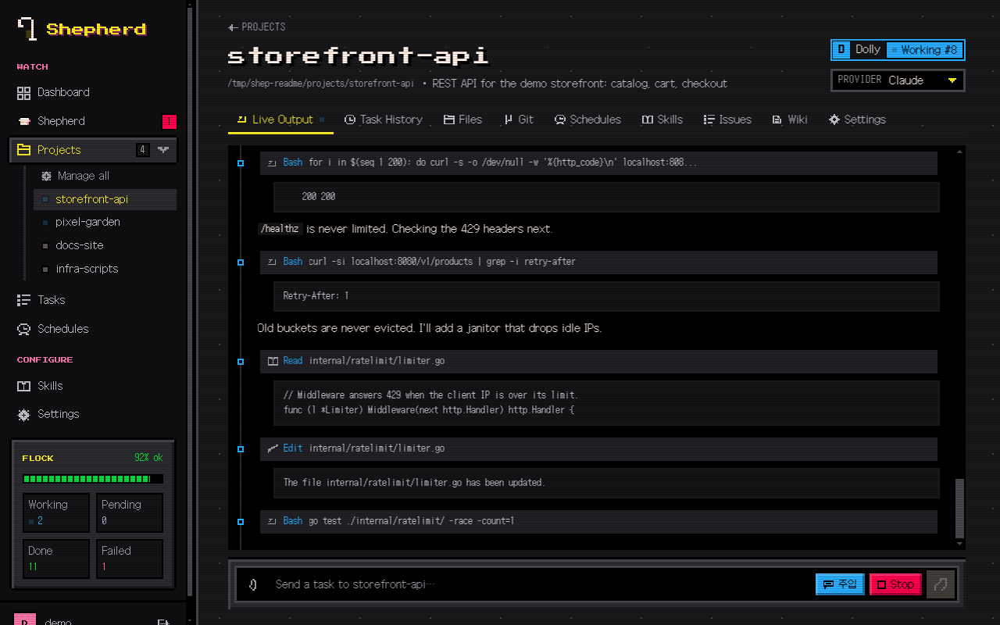
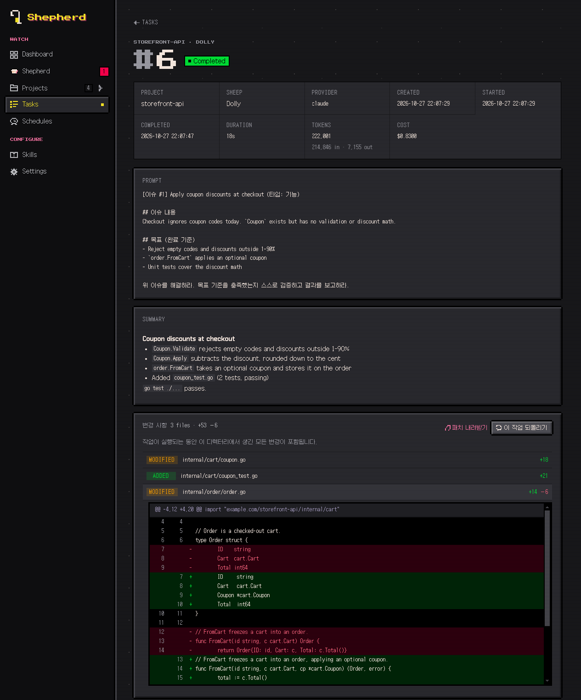
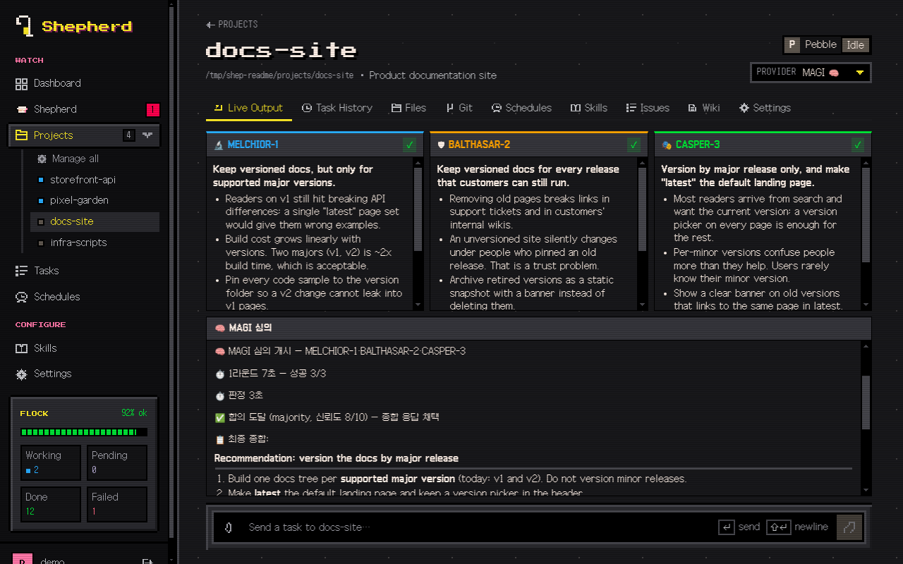
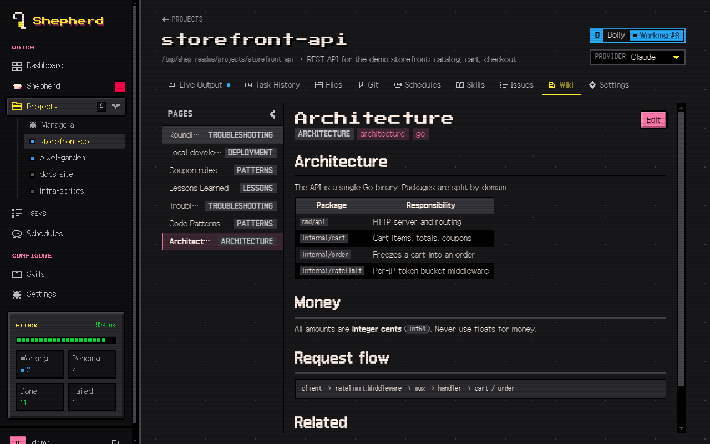

# Shepherd

AI 코딩 에이전트 무리를 내 서버에서 관리하는 관제실입니다. 프로젝트마다 전담 에이전트("양")가 하나씩 붙고, 관리자 에이전트("목자")가 일을 나눠 주고 진행을 지켜보며 결과를 검토합니다. 이 모든 일을 하나의 Web UI에서 다룹니다.

> For the English version, see [README.md](README.md).



## 주요 특징

- **프로젝트마다 양 한 마리.** 양들은 각자의 저장소에서 병렬로 일하고, 출력은 실시간으로 스트리밍됩니다.
- **양 떼를 관리하는 목자.** 원하는 일을 목자에게 말하면, 목자가 이슈를 쓰고 프로젝트 양에게 위임합니다. 작업이 끝나면 목자가 깨어나서 결과를 검토합니다.
- **모든 변경은 되돌릴 수 있습니다.** 작업이 시작하기 전과 끝난 뒤의 작업 트리를 스냅숏으로 남기므로, 작업이 정확히 무엇을 바꿨는지 보고 되돌릴 수 있습니다.
- **다양한 AI 백엔드.** Claude Code, OpenCode, Pi, Grok CLI를 지원하고, 내장 에이전트로 로컬 모델이나 호스팅 모델을 쓸 수 있으며, 세 모델이 합의하는 MAGI 엔진도 있습니다.
- **프로젝트 기억.** 프로젝트마다 이슈 트래커와 위키가 있고, 에이전트가 이를 읽고 갱신합니다.
- **내 컴퓨터에서 실행.** Web UI가 내장된 Go 바이너리 하나로 동작합니다. PWA로 설치하면 푸시 알림도 받을 수 있습니다.

## Web UI

### 대시보드

대시보드에서 양 떼 전체를 한눈에 봅니다. 어떤 양이 일하고 어떤 양이 쉬는지, 실행 중인 모든 작업의 실시간 출력, 프로젝트별·모델별 토큰 사용량(5시간부터 1년까지), 최근 작업이 한 화면에 나옵니다. 실행 중인 양의 카드에서 추가 지시를 보낼 수 있습니다. 모니터링 화면은 실행 중인 작업을 모두 나란히 보여 줍니다.

### 목자

목자는 자기 프로젝트가 없는 관리자 에이전트입니다. 목자는 코드를 직접 고치지 않고, 이슈를 통해 일을 위임합니다.

1. 콘솔에서 목자에게 지시합니다.
2. 목자가 이슈를 만들거나 고른 뒤, 알맞은 프로젝트 양에게 **감시**를 켠 상태로 실행합니다.
3. 감시 중인 작업이 끝나면 목자가 깨어나서 결과를 검토합니다. 그리고 이슈를 닫거나, 지침을 더해서 다시 실행하거나, 후속 이슈를 엽니다.
4. 주기적인 **순찰**이 LLM 없이 코드만으로 모든 프로젝트를 점검합니다. 실패하거나 멈춘 작업처럼 새로 생긴 문제가 있을 때에만 목자를 깨웁니다.



목자 화면에는 목자 작업 기록, 순찰 기록, **전 프로젝트 이슈 보드**, 그리고 사용자의 결정이 필요한 항목을 모은 **확인 필요** 목록도 있습니다. 권한 단계(보고만, 계획, 실행, 전권)와 하루 깨우기 횟수, 동시 위임 수, 비용 상한으로 목자의 행동 범위를 제한합니다. 이 설정은 모두 **설정 → 목자**에서 합니다.



### 프로젝트 작업 공간

프로젝트마다 **Live Output**, **Task History**, **Files**, **Git**, **Schedules**, **Skills**, **Issues**, **Wiki**, **Settings** 탭이 있는 작업 공간이 있습니다. Live Output에서 작업을 보내고, 실행 중인 작업에 지시를 추가하거나 작업을 중단합니다. 화면 위쪽에서 양의 프로바이더와 모델을 바꿀 수 있습니다.



- **Files**: 프로젝트 파일을 둘러보고 내려받습니다.
- **Git**: 커밋 그래프, 브랜치, diff를 봅니다. 브라우저에서 stage, commit, push를 할 수 있습니다.
- **Issues**: 설계, 기능, 버그 유형의 작은 이슈 트래커입니다. **실행**을 누르면 이슈가 대기열의 작업이 되고, 작업과 이슈의 연결이 유지됩니다.
- **Schedules**: cron이나 일정 간격으로 작업을 자동으로 만듭니다.
- **Settings**: 양이 쓸 MCP 서버 같은 프로젝트별 옵션을 정합니다.

### 작업 변경 내역과 되돌리기

작업 상세 화면은 프롬프트, 요약, 비용과 토큰, 전체 출력, 그리고 **작업이 바꾼 모든 파일**을 파일별 diff와 함께 보여 줍니다. 변경 내역을 패치 파일로 내려받거나 작업을 되돌릴 수 있습니다. 되돌리기는 3-way merge를 쓰므로 작업 뒤에 생긴 수정은 그대로 남습니다. 스냅숏은 숨은 git ref에 저장되므로, 사용자의 index, HEAD, 커밋 기록은 바뀌지 않습니다.



### MAGI: 세 모델, 하나의 답

MAGI는 같은 질문을 세 심의자에게 동시에 묻습니다. 심의자마다 다른 페르소나를 씁니다(MELCHIOR-1: 기술적 정밀성, BALTHASAR-2: 안전, CASPER-3: 실용성). 별도의 판정자가 답변을 비교해서 하나의 종합 답변을 씁니다. 합의 수준이 낮으면 익명 토론 라운드를 한 번 더 진행합니다. 심의자마다 다른 백엔드를 쓸 수 있으며, 서로 다른 계열의 모델을 섞는 것을 권장합니다. MAGI는 조언만 합니다. 심의자는 파일을 읽고 브라우저를 쓸 수 있지만, 코드를 고칠 수는 없습니다.



### 위키

프로젝트마다 아키텍처 메모, 주의할 점, 운영 절차를 담는 마크다운 위키가 있습니다. 에이전트는 작업을 시작하기 전에 관련 문서를 읽고, 작업을 마친 뒤 문서를 추가하거나 고칠 수 있습니다. 그래서 작업 사이에 지식이 이어집니다.



### 그 밖의 기능

- **스킬**: 전역 또는 프로젝트별로 재사용하는 프롬프트 템플릿입니다. 에이전트는 필요할 때에만 전체 내용을 읽습니다.
- **알림**: 작업 완료와 실패, 목자 보고를 PWA 웹 푸시와 Discord 웹훅으로 받습니다.
- **양 이름**: 프로젝트를 추가할 때 LLM이 프로젝트에 어울리는 이름을 새 양에게 지어 줄 수 있습니다. 양 이름은 언제든지 바꿀 수 있습니다.
- **계정**: 로그인 아이디와 비밀번호는 **설정 → 공통**에서 바꿉니다. 바꾸면 다른 기기의 로그인 세션이 모두 해제됩니다.

## 프로바이더

양 한 마리는 프로바이더 하나를 씁니다. 한 무리 안에서 여러 프로바이더를 섞어 쓸 수 있고, 양의 프로바이더는 언제든지 바꿀 수 있습니다.

| 프로바이더 | 백엔드 |
|------------|--------|
| `claude` | Claude Code CLI (기본값) |
| `opencode` | OpenCode CLI |
| `pi` | Pi coding agent CLI |
| `grok` | Grok CLI |
| `embedded` | OpenAI 호환 엔드포인트용 내장 에이전트 루프 (llama.cpp, vLLM, Ollama, LM Studio, GitHub Copilot) |
| `magi` | 위 백엔드들을 조합한 세 모델 합의 |

CLI 프로바이더는 각자의 로그인을 사용하므로, Shepherd는 이들의 API 키를 저장하지 않습니다. 임베디드 엔드포인트 추가와 MAGI 구성은 **설정**에서 합니다.

## 시작하기

필요한 것: **Go 1.25 이상**, **Node.js 18 이상**, 그리고 프로바이더 하나 이상(예: `PATH`에 있는 Claude Code CLI 또는 OpenAI 호환 엔드포인트).

```bash
git clone https://github.com/agurrrrr/shepherd.git
cd shepherd
make install            # Web UI와 바이너리를 빌드해서 ~/.local/bin에 복사

shepherd auth setup     # Web UI 로그인 계정 만들기
shepherd serve -d       # 데몬 시작
```

`http://localhost:8585`를 열고 로그인한 뒤, **Projects → Add project**에서 첫 프로젝트를 추가합니다. Shepherd가 그 프로젝트의 양을 만들어 주므로, 바로 작업을 보낼 수 있습니다.

설정은 `~/.shepherd/config.yaml`에, 작업 데이터베이스는 `~/.shepherd/shepherd.db`에 저장됩니다. 거의 모든 옵션을 **설정** 화면에서 바꿀 수 있습니다. 파일 업로드 한 개의 크기는 기본 10MB이며, **설정 → 공통 → Max Upload Size**에서 새 제한을 지정하십시오. 셸(bash) 명령의 기본 실행 한도는 10분이고, **설정 → 공통 → Bash 도구 타임아웃**에서 새 값을 지정할 수 있습니다. 외부 네트워크에서 접속하려면 데몬 앞에 HTTPS 리버스 프록시를 두십시오. 프록시가 허용하는 본문 크기도 업로드 제한과 같은 값으로 맞춰 주십시오.

Shepherd는 MCP 서버(`shepherd mcp`)로도 동작합니다. 이 서버는 에이전트에게 이슈, 위키, 작업 기록, 스킬, 브라우저 자동화 도구를 제공합니다.

## 서비스로 실행하기 (systemd)

데몬을 계속 실행하는 권장 방법은 **systemd 사용자 유닛**입니다. 이 방법은 `sudo`가 필요 없고, 잔류(linger)를 켜면 로그아웃 뒤에도 데몬이 유지됩니다. 저장소의 `deploy/shepherd.service`가 이 방법용입니다.

```bash
mkdir -p ~/.config/systemd/user
cp deploy/shepherd.service ~/.config/systemd/user/shepherd.service
systemctl --user daemon-reload
systemctl --user enable --now shepherd
loginctl enable-linger $USER   # 로그아웃 뒤에도 데몬 유지 (선택)
```

`deploy/shepherd.system.service`는 선택용 **시스템 유닛**입니다. 이 유닛은 지정한 한 사용자로 부팅 시에 시작합니다. 이런 동작이 필요할 때만 쓰고, 먼저 유닛 안의 `User=`와 `PATH`를 본인 계정에 맞게 고치십시오. 이 방법에는 `sudo`가 필요합니다.

두 유닛 모두 `serve -d`가 아니라 `serve-foreground`를 실행합니다. systemd 아래에서는 프로세스가 포그라운드에 남아야 `Restart=`가 동작합니다. `serve -d`는 분리된 자식 프로세스를 만들기 때문에, systemd가 그 자식을 추적할 수 없습니다.

### PATH와 설치 디렉터리

설치 디렉터리는 `make install`과 `install.sh`가 설치하는 `$HOME/.local/bin`으로 정하고, 이 디렉터리를 PATH **앞에** 두십시오.

```bash
export PATH="$HOME/.local/bin:$PATH"
```

앞에 두는 이유는 셸과 systemd가 방금 설치한 바이너리를 해석하게 하기 위해서입니다. 이렇게 하지 않으면 다른 위치에 남아 있던 오래된 사본(예: 낡은 `/usr/local/bin/shepherd`)이 해석됩니다. systemd 유닛은 셸 로그인 프로필을 읽지 않으므로, 유닛 파일 자체에도 `~/.local/bin`을 포함하는 `PATH`를 지정해야 합니다. 이 값이 없으면 데몬이 `~/.local/bin`에 설치된 `claude`, `grok` 같은 프로바이더 CLI를 찾지 못해서, 작업이 `exec: "claude": executable file not found in $PATH` 오류로 실패합니다. 동봉된 유닛에는 이미 이 PATH가 들어 있습니다.

### 실행 중인 바이너리 확인하기

설치 뒤에 데몬을 재시작하기 전에, 실행 중인 프로세스가 방금 빌드한 바이너리인지 확인하십시오. 새 바이너리를 설치해도 오래된 데몬은 계속 서비스됩니다.

```bash
shepherd --version                     # PATH에 있는 바이너리의 버전과 빌드 시각
readlink -f "$(command -v shepherd)"   # 그 바이너리의 절대 경로
# systemd가 관리하는 데몬이면, 유닛이 실제로 무엇을 실행하는지 확인합니다:
systemctl --user cat shepherd 2>/dev/null || systemctl cat shepherd
```

`shepherd --version`이 오래된 빌드 시각을 보이거나, 해석된 경로가 `$HOME/.local/bin/shepherd`가 아니면, 다른 사본이 실행 중인 것입니다. 데몬은 모든 에이전트 세션의 부모이므로, 재시작하면 진행 중인 작업이 종료됩니다. 진행 중인 작업이 없을 때만 데몬을 재시작하십시오.

## 개발

```bash
go build ./... && go test ./...
cd web && npm install && npm run dev    # Web UI 개발 서버
```

[CONTRIBUTING.md](CONTRIBUTING.md)와 [ARCHITECTURE.md](ARCHITECTURE.md)를 참고하십시오.

## 라이선스

MIT. [LICENSE](LICENSE)를 참고하십시오.

---

> ***"여호와는 나의 목자시니 내게 부족함이 없으리로다."*** (시편 23:1)
